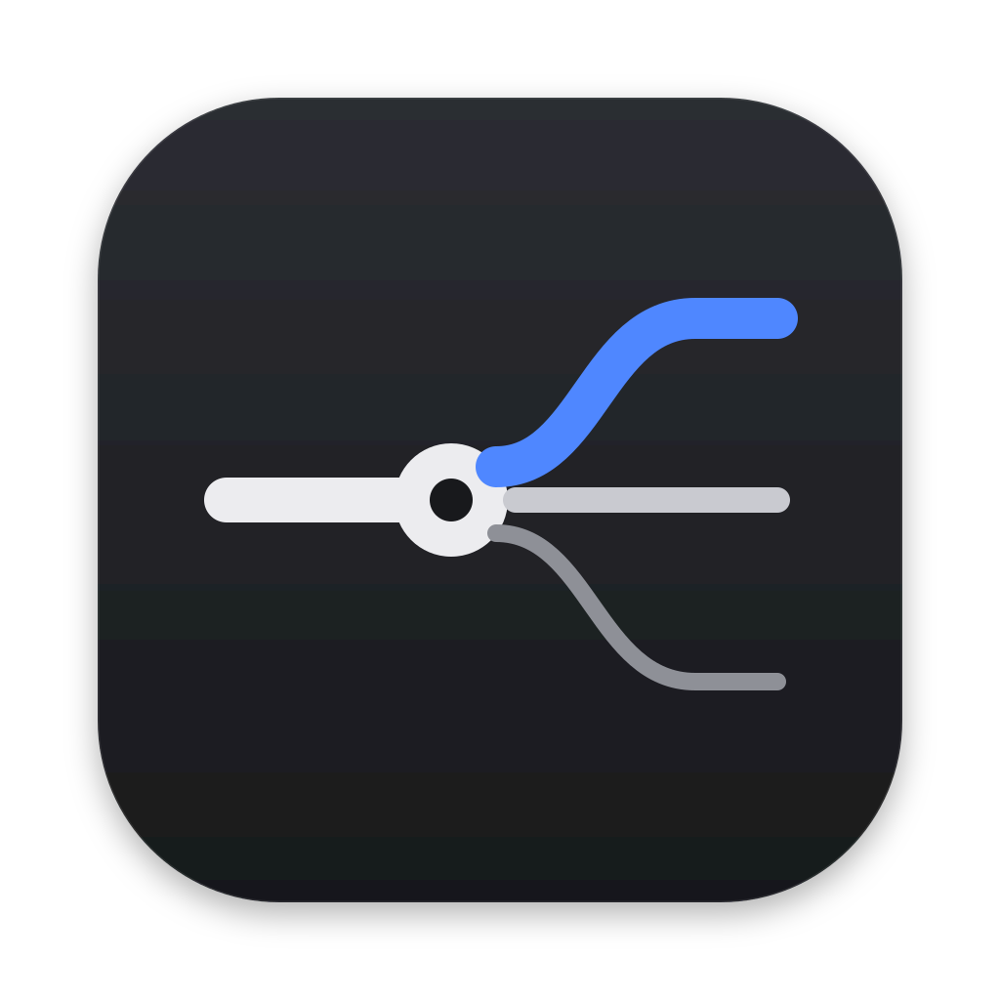

<p align="center"></p>

# 2110 Viewer

**English** | [Deutsch](README.de.md)

**Receive, send and analyze ST 2110 on the Mac.** Made for teaching.

**[Download DMG](https://github.com/BenjaminJMueller/2110/releases/latest/download/2110-Viewer.dmg)** (macOS 14 or later, Apple Silicon)

| Receive | Send | Analyze |
|---|---|---|
| ST 2110-20 (YCbCr 4:2:2, 10/8-bit) and ST 2110-30 (up to 64 channels) | Test pattern, lip-sync test, video file or camera as ST 2110-20/-30 | pcap/pcapng with ST 2110 traffic, modeled on EBU LIST |
| Sources found automatically via NMOS IS-04, or SDP by drag and drop | Announces itself as an NMOS source, connects receivers via IS-05 | Loss, packet spacing, format detection without SDP, Cinst/VRX per ST 2110-21 |
| Lip sync via RTP timestamps or as a passive PTP slave | Timestamps from the PTP grandmaster, evenly paced packets | Audio TS-DF, PTP domains and grandmasters, IGMP querier, thumbnail |
| Monitor a single channel or any stereo pair, choose the output device; full-screen picture on a second display or projector | macOS decodes files itself (H.264, HEVC, ProRes, AAC) | Record a capture straight from reception |

The app follows the system language (English or German).

## Installation

Open the DMG, drag **2110 Viewer** to **Applications** and launch it. GStreamer and all libraries are included in the app. Until the app is notarized (there is no Apple Developer account yet), choose *System Settings › Privacy & Security › Open Anyway* once on first launch. Details: [user guide](docs/en/user-guide.md).

The DMG is published under [Releases](https://github.com/BenjaminJMueller/2110/releases), together with the source package of the embedded libraries and the license reports. Builds in between are available as an artifact of every CI run (Actions › “Build und Tests” › *2110-Viewer-dmg*).

## Documentation

| | |
|---|---|
| [User guide](docs/en/user-guide.md) | for users without prior knowledge |
| [Compatibility](docs/en/compatibility.md) | models, firmware and formats with test status |
| [Synchronization](docs/en/synchronization.md) | preview, RTP-aligned, PTP; role in the PTP network |
| [Sending](docs/en/sending.md) | sources, time reference, NMOS/IS-05, data rates |
| [Analysis](docs/en/analysis.md) | measurements, formulas, limits |
| [Network adapters](docs/en/network-adapters.md) | compatible 10GbE adapters with approximate prices |
| [Test plan](docs/en/test-plan.md) | acceptance tests with real equipment, feedback template |
| [Feasibility](docs/en/feasibility.md) | devices, manufacturer information, GStreamer review |
| [Build and distribution](docs/en/build-and-distribution.md) | reproducible build, DMG, signing, notarization |
| [LGPL sources](docs/en/lgpl-sources.md) | source code of the embedded libraries |

German originals are in [docs/](docs/).

## Layout

```
core/              C core (GStreamer), platform-neutral, tested on Linux
  src/             SDP, multicast socket, media clock, receiver, sender, analyzer, self-test
  tools/           st2110-probe, st2110-send, st2110-analyze, st2110-testsender
  tests/           unit, loopback, sender, analyzer and PTP tests
App/Sources/
  ST2110Kit/       NMOS client and node, grouping, address ranges, diagnostics (testable)
  ST2110Viewer/    SwiftUI app, Metal renderer, AVFoundation, CoreAudio
App/Localization/  translation table German → English
scripts/           fetch GStreamer, build, embed, audit, DMG, notarize, source package
packaging/         Info.plist, icon (SVG), license texts, DMG notes
site/              project website (GitHub Pages)
```

## Building

```bash
./scripts/build-app.sh          # macOS with Xcode 26, produces dist/2110 Viewer.app and dist/2110-Viewer-<version>.dmg
make -C core && make -C core test   # core and tests (Linux, or macOS with pkg-config)
```

GitHub Pages: in the repository settings choose *Pages › Source: GitHub Actions*; the `Webseite` workflow publishes `site/` on changes to `main`.

## License

Code: [MIT](LICENSE). The app includes GStreamer and other libraries under LGPL-2.1, BSD, MIT and zlib; see [THIRD_PARTY_NOTICES](THIRD_PARTY_NOTICES.md). The repository contains no manufacturer files.
